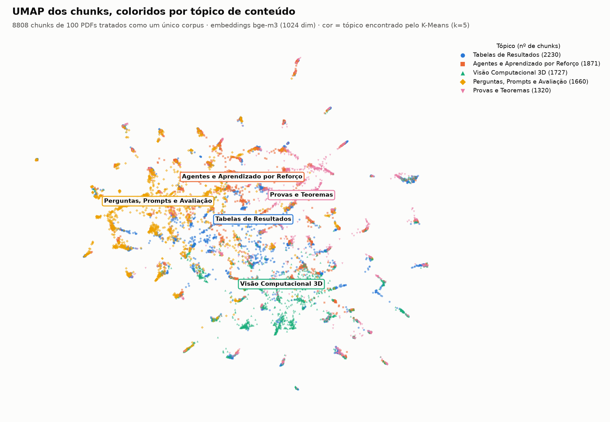
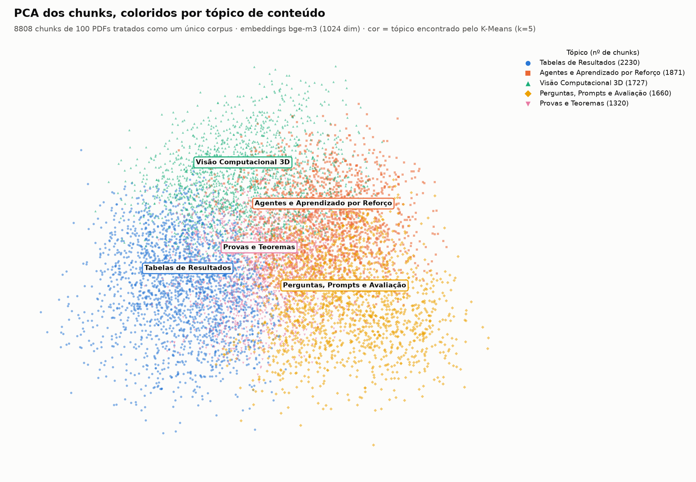
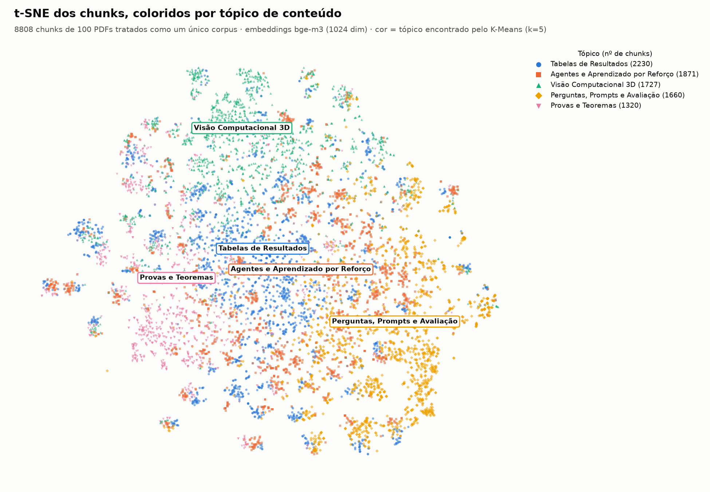
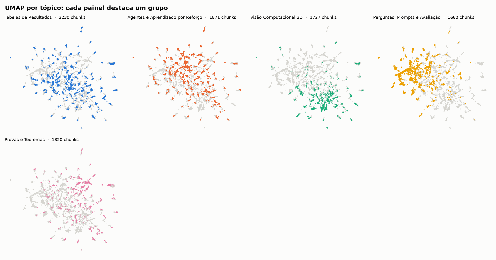

# RAG-Demo 100% local (sem créditos de API)

Esta variante roda o RAG-Demo inteiro na própria máquina: o **LLM** (`qwen2.5:7b`) e os **embeddings** (`bge-m3`, 1024 dimensões, multilíngue) rodam no [Ollama](https://ollama.com), com GPU. Nenhuma chave da OpenAI ou do Gemini é necessária.

O corpus são os **100 PDFs de IA do arXiv** do projeto vizinho `../ia_arxiv_qdrant/pdfs` (20 por categoria: cs.AI, cs.LG, cs.CL, cs.CV, cs.RO).

## Como funciona

O Ollama expõe uma API compatível com a da OpenAI. Por isso o código do app quase não muda:

- `OPENAI_BASE_URL=http://ollama:11434/v1` faz todas as chamadas `ChatOpenAI` do app irem para o Ollama.
- Um novo modelo de embedding `local` (`src/config.py`) usa o `bge-m3` pelo mesmo endpoint.
- `USE_N8N=false` faz o chat usar o processamento local direto, sem o workflow do n8n.
- `ENHANCE_WITH_LLM=false` desliga a reformatação do texto inteiro pelo LLM no upload, que é lenta com um modelo local e artigos longos.

Tudo isso está em `docker-compose.local.yml`, que também:

- usa volumes nomeados, para os bancos não ficarem dentro da pasta do OneDrive;
- troca `minio/minio`, que saiu do Docker Hub, por `pgsty/minio`, um fork com a mesma CLI.

## Passo a passo

Requisitos: Docker Desktop com WSL2 e GPU NVIDIA. Em CPU funciona, porém bem mais devagar; para isso, remova o bloco `deploy` do serviço `ollama`.

```powershell
copy env.example .env
docker compose -f docker-compose.yml -f docker-compose.local.yml up -d --build

# Modelos locais (uma vez só, cerca de 6 GB)
docker exec ollama ollama pull qwen2.5:7b
docker exec ollama ollama pull bge-m3

# Ingestão dos 100 PDFs: MinIO -> chunks de 1.000 caracteres -> bge-m3 -> Qdrant (cerca de 10 min)
docker exec rag-demo-app python scripts/ingest_arxiv_pdfs.py --collection artigos_ia
```

Rode a ingestão **uma única vez**. O app gera os IDs dos pontos a partir do horário, então duas ingestões simultâneas podem duplicar ou sobrescrever pontos. O script pula os PDFs que já estão na collection, então pode ser reexecutado depois de uma interrupção.

Abra <http://localhost:5000>, clique em **Busca por Similaridade** na barra lateral, escolha a collection `artigos_ia`, digite a pergunta no campo "Digite sua consulta para busca por similaridade..." e clique em **Enviar**. Apesar do nome, essa tela gera a resposta com o LLM local e mostra os trechos usados. A tela **Chat Multi-Agente** passa pelo n8n com OpenAI e Gemini, então não funciona nesta variante local.

## Tópicos por conteúdo e visualizações

O script de tópicos roda no host:

```powershell
python -m venv .venv
.\.venv\Scripts\python.exe -m pip install qdrant-client numpy scikit-learn umap-learn matplotlib requests
.\.venv\Scripts\python.exe scripts\cluster_topics.py --k 7 --nomes visualizacoes\nomes_topicos_v1.json
.\.venv\Scripts\python.exe scripts\limpar_corpus.py
.\.venv\Scripts\python.exe scripts\cluster_topics.py --k 5 --nomes visualizacoes\nomes_topicos.json
```

Ele trata **todos os PDFs como um único corpus**: o K-Means agrupa os embeddings de chunks sem saber de qual arquivo ou categoria cada um veio. O `k` entre 5 e 8 é escolhido pela silhueta; o limite de 8 é o número de cores distinguíveis da paleta. O LLM local sugere um nome para cada grupo a partir dos termos mais distintivos e dos trechos centrais. Os nomes finais foram revisados à mão em `visualizacoes/nomes_topicos.json`, e `topicos.json` guarda a sugestão original.

### Limpeza do corpus

O primeiro agrupamento (10.509 chunks, k=7) revelou dois grupos que atrapalham o RAG:

| Tópico removido | Chunks | Por que sai |
| --- | --- | --- |
| Referências Bibliográficas | 1.598 | listas "Autor et al. (2023). Título…": casam com perguntas genéricas pelos títulos citados. Antes da limpeza, "Quais artigos falam sobre chain-of-thought?" recuperava 5 de 5 chunks de referências. |
| Casos Clínicos Pediátricos | 103 | Apêndice C do artigo AI Consilium, um laudo médico reproduzido por extenso (chunks 158 a 260 de 288); o corpo do artigo foi mantido |

`scripts/limpar_corpus.py` cria um snapshot da collection no Qdrant (backup) e apaga esses chunks. Citações dentro do texto corrido, como "(Schulman et al., 2017)" numa introdução, continuam, pois fazem parte do conteúdo.

Resultado depois da limpeza (8.808 chunks, `visualizacoes/topicos.md`):

| Tópico | Chunks | O que é |
| --- | --- | --- |
| Tabelas de Resultados | 2.230 | métricas e tabelas experimentais de quase todos os artigos |
| Agentes e Aprendizado por Reforço | 1.871 | agentes de LLM, políticas, tarefas |
| Visão Computacional 3D | 1.727 | câmera, cena, geometria, vídeo |
| Perguntas, Prompts e Avaliação | 1.660 | exemplos de prompts, QA, SQL, rubricas |
| Provas e Teoremas | 1.320 | lemas, provas, limites |

Os grupos misturam **temas** (agentes, visão 3D) e **tipos de texto** comuns a todos os artigos (tabelas, provas). Isso é esperado num agrupamento por chunk: uma tabela de resultados de um artigo de robótica se parece mais com as tabelas de um artigo de NLP do que com o resto do próprio artigo.

Imagens geradas:

| UMAP | PCA | t-SNE |
| --- | --- | --- |
|  |  |  |



Cada tópico também tem um formato de marcador e um rótulo no gráfico, então a leitura não depende só da cor.

### No painel do Qdrant

O script grava `topico` e `cluster_id` no payload de cada ponto. Também marca uma amostra estratificada de cerca de 2.000 pontos com `amostra_viz`, porque a aba Visualize calcula a projeção no navegador.

1. Abra <http://localhost:6333/dashboard#/collections/artigos_ia/visualize> e informe a API key do `.env` (`QDRANT_API_KEY`).
2. Cole o conteúdo de `visualizacoes/qdrant_umap.json`, `qdrant_pca.json` ou `qdrant_tsne.json` e clique em **RUN**. A cor vem de `topico`.

## Perguntas ao chat

```powershell
.\.venv\Scripts\python.exe scripts\ask_chat.py
```

O script envia 8 perguntas à mesma API `/api/chat` usada pela interface. São 7 sobre artigos específicos, com gabarito tirado do resumo no arXiv, e 1 fora do corpus. O resultado fica em [`visualizacoes/perguntas_chat.md`](visualizacoes/perguntas_chat.md).

Na execução registrada, feita depois da limpeza do corpus, as 7 respostas bateram com o gabarito e citaram o artigo correto. Na pergunta fora do corpus, sobre receita de pão de queijo, o modelo disse que o contexto não tinha a informação. Cada resposta levou entre 2 e 9 segundos numa RTX 3060.

## Correções feitas no código original

- `vector_store.search_similar`: `QdrantClient.search` foi removido no qdrant-client 1.20 (instalado pelo `requirements.txt`, que não fixa versão) e foi trocado por `query_points`.
- `chat_rag_service.generate_response`: o contexto lia `doc['text']`, mas a busca devolve o trecho em `content`. Sem n8n, o LLM recebia contexto vazio. Agora usa `content` e identifica cada trecho pelo título do artigo.
- `vector_store._get_real_document_count`: lia o payload completo de até 10.000 pontos a cada mensagem do chat. Agora pagina e traz só o nome do arquivo.
