# Resultados: tópicos dos 100 artigos de IA e testes do chat RAG

Esta pasta reúne os resultados do RAG-Demo rodando 100% local (veja [`../LOCAL.md`](../LOCAL.md) para reproduzir).

**Resumo:**
- Os 100 PDFs foram tratados como um único corpus.
- Os chunks foram agrupados por conteúdo em 5 tópicos.
- Referências bibliográficas e um apêndice médico foram removidos porque atrapalhavam o RAG.
- O chat respondeu corretamente às 7 perguntas com gabarito e recusou a pergunta fora do corpus.

## 1. Dados

| Item | Valor |
| --- | --- |
| Corpus | 100 artigos recentes do arXiv, 20 de cada categoria: cs.AI, cs.LG, cs.CL, cs.CV, cs.RO |
| Chunks | 10.509 na ingestão, 8.808 depois da limpeza (1.000 caracteres cada) |
| Embeddings | `bge-m3` no Ollama, 1.024 dimensões, multilíngue |
| LLM do chat | `qwen2.5:7b` no Ollama, numa RTX 3060 de 12 GB |
| Banco vetorial | Qdrant, distância de cosseno, collection `artigos_ia` |

## 2. Como os tópicos foram encontrados

Nenhuma informação de arquivo ou de categoria do arXiv entra no agrupamento: a cor de cada ponto vem só do **conteúdo** do trecho.

1. **K-Means** sobre os embeddings dos chunks, com `k` escolhido entre 5 e 8 pela maior silhueta de cosseno.
2. **Termos característicos** de cada grupo, por log-odds: palavras frequentes no grupo e raras nos outros.
3. **Nome de cada tópico**, sugerido pelo LLM local a partir dos termos e dos trechos mais centrais, e depois revisado à mão.
4. **Projeção em 2D** com UMAP, PCA e t-SNE, só para visualizar: o agrupamento é feito nas 1.024 dimensões originais.

## 3. Limpeza do corpus

O primeiro agrupamento (10.509 chunks, k=7) encontrou dois grupos que não são conteúdo útil para o RAG:

| Grupo removido | Chunks | Motivo |
| --- | --- | --- |
| Referências Bibliográficas | 1.598 | Listas como "Autor et al. (2023). Título…". Casavam com perguntas genéricas pelos títulos citados e tomavam o contexto. Antes da limpeza, a pergunta *"Quais artigos falam sobre chain-of-thought?"* recuperava **5 de 5** chunks de referências. |
| Casos Clínicos Pediátricos | 103 | Apêndice C do artigo *AI Consilium*: um laudo médico reproduzido por extenso, sem conteúdo de IA. O corpo do artigo foi mantido. |

Esses dois grupos eram os mais fáceis de separar (silhueta 0,24 e 0,41, contra 0,01 a 0,04 dos outros), justamente por serem textos muito diferentes do resto. Antes de apagar, `scripts/limpar_corpus.py` cria um snapshot da collection como backup.

## 4. Tópicos finais

Depois da limpeza, a silhueta escolheu **k = 5**:

| Tópico | Chunks | PDFs com trechos | Termos característicos | Artigo com mais trechos |
| --- | --- | --- | --- | --- |
| Tabelas de Resultados | 2.230 | 97 | table, gpt-, mean, claude, accuracy, sft | MJev-Spatial |
| Agentes e Aprendizado por Reforço | 1.871 | 94 | policy, agent, agentic, tasks, reinforcement learning | OS-Helix |
| Visão Computacional 3D | 1.727 | 68 | camera, frame, geometry, scene, video | SUPRA-TEX |
| Perguntas, Prompts e Avaliação | 1.660 | 74 | sql, answer, evidence, question, json, patient | MindEval2 |
| Provas e Teoremas | 1.320 | 88 | probability, lemma, inequality, proof, theorem, bound | Learning Rational Strategies… |

Os tópicos misturam **assuntos** (agentes, visão 3D) com **tipos de texto** que aparecem em quase todos os artigos (tabelas, provas, prompts). Isso é natural num agrupamento por chunk: a tabela de resultados de um artigo de robótica se parece mais com a tabela de um artigo de NLP do que com a introdução do próprio artigo. Por isso "Tabelas de Resultados" tem trechos de 97 dos 100 PDFs, enquanto "Visão Computacional 3D", um assunto, aparece em 68.

A silhueta média é baixa (0,036). Os tópicos são regiões de uma nuvem contínua, não ilhas separadas, e as projeções abaixo mostram isso.

Detalhes por tópico: [`topicos.md`](topicos.md).

## 5. Visualizações no painel do Qdrant

Capturas da aba *Visualize* do Qdrant. Cada imagem mostra uma amostra estratificada de 2.000 chunks com a cor dada pelo campo `topico`. Para gerar de novo, cole no painel o JSON de [`qdrant_umap.json`](qdrant_umap.json), [`qdrant_pca.json`](qdrant_pca.json) ou [`qdrant_tsne.json`](qdrant_tsne.json).

Nas capturas do Qdrant, Visão Computacional 3D é **laranja**, Perguntas é **verde** e Provas é **roxo**. Nos gráficos gerados pelo script (seção 6), as cores são outras; a legenda de cada imagem é a referência.

### UMAP

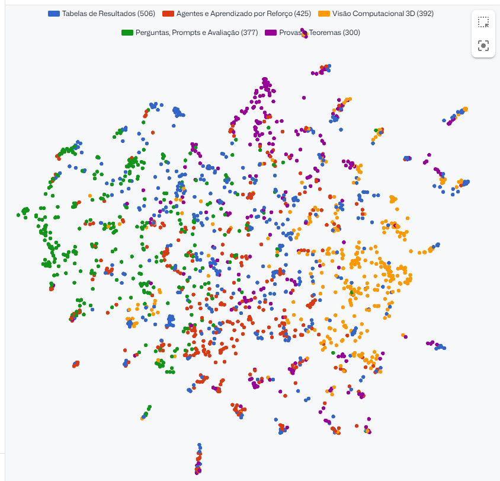

O UMAP preserva a vizinhança local e forma várias "ilhas" pequenas. Cada ilha geralmente reúne trechos parecidos de um mesmo artigo, como uma sequência de tabelas ou de provas. **Perguntas e Prompts** (verde) se concentra à esquerda, **Visão 3D** (laranja) à direita, e **Provas e Teoremas** (roxo) aparece no alto e em pequenas ilhas espalhadas. O centro mistura Tabelas e Agentes, os dois tópicos mais "genéricos".

### PCA

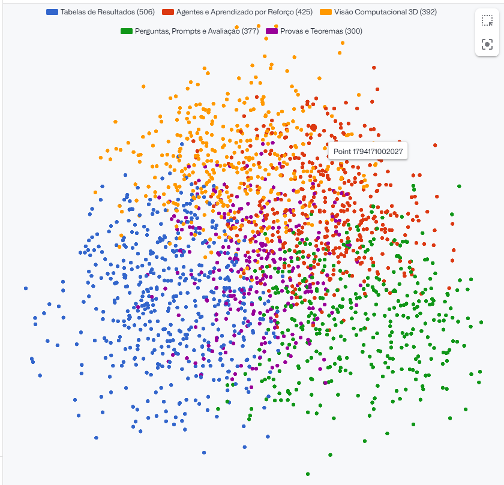

O PCA é uma projeção linear das duas direções de maior variância. Ele não forma ilhas, mas mostra a estrutura geral com clareza. Os cinco tópicos ocupam **setores bem definidos** de uma única nuvem:
- Tabelas de Resultados (azul) à esquerda;
- Perguntas e Prompts (verde) à direita;
- Visão 3D (laranja) e Agentes (vermelho) em cima;
- Provas e Teoremas (roxo) no centro, onde se sobrepõe a todos.

A separação aparece mesmo numa projeção linear simples, o que indica que os tópicos correspondem a direções reais do espaço de embeddings.

### t-SNE

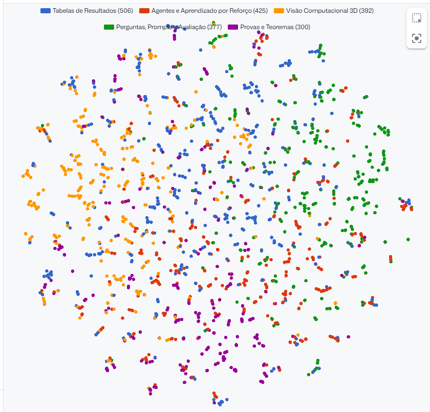

O t-SNE espalha os pontos num disco quase uniforme e realça grupos bem pequenos. Mesmo assim, as tendências se repetem: **Visão 3D** (laranja) se concentra à esquerda, **Perguntas e Prompts** (verde) à direita, e **Provas e Teoremas** (roxo) embaixo. Os vários pares e trios de pontos da mesma cor são chunks consecutivos do mesmo artigo.

**Leitura conjunta:** as três projeções, com métodos bem diferentes, mostram a mesma organização. Perguntas e Prompts fica de um lado, Visão 3D do outro, e Tabelas e Agentes ficam no meio, ligando tudo. Isso dá confiança de que os tópicos refletem o conteúdo, e não um artefato de uma projeção específica.

## 6. Gráficos gerados pelo script

Gerados por `scripts/cluster_topics.py` com **todos os 8.808 chunks**. Cada tópico tem uma cor e também um formato de marcador, então a leitura não depende só da cor.

| UMAP | PCA | t-SNE |
| --- | --- | --- |
| 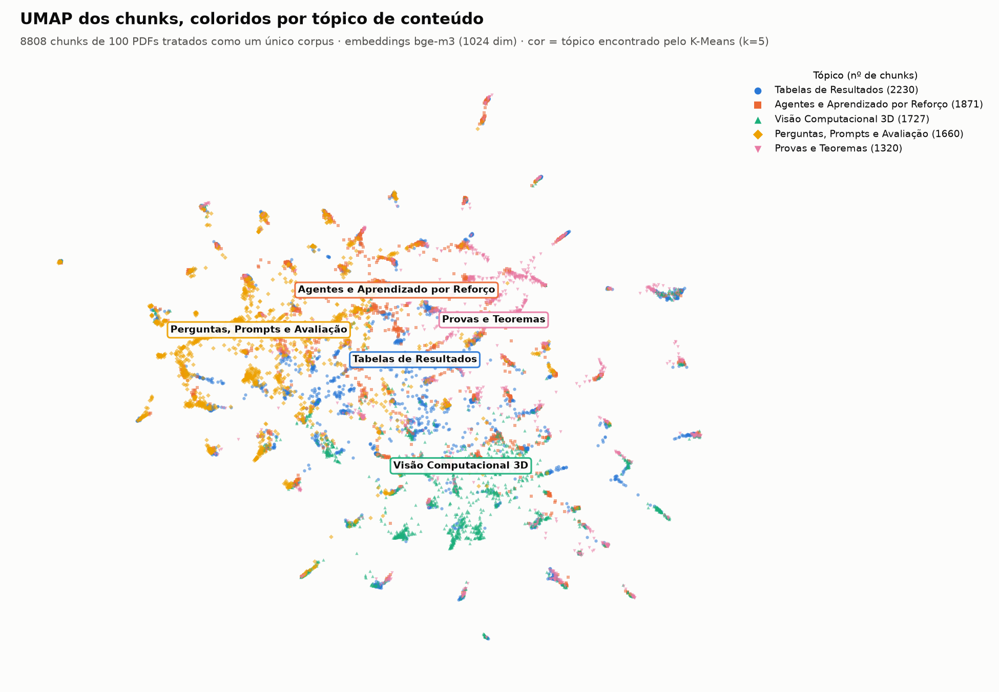 | 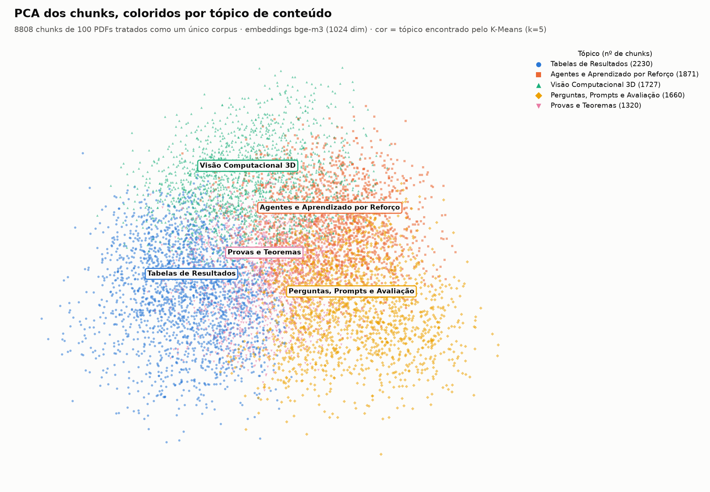 | 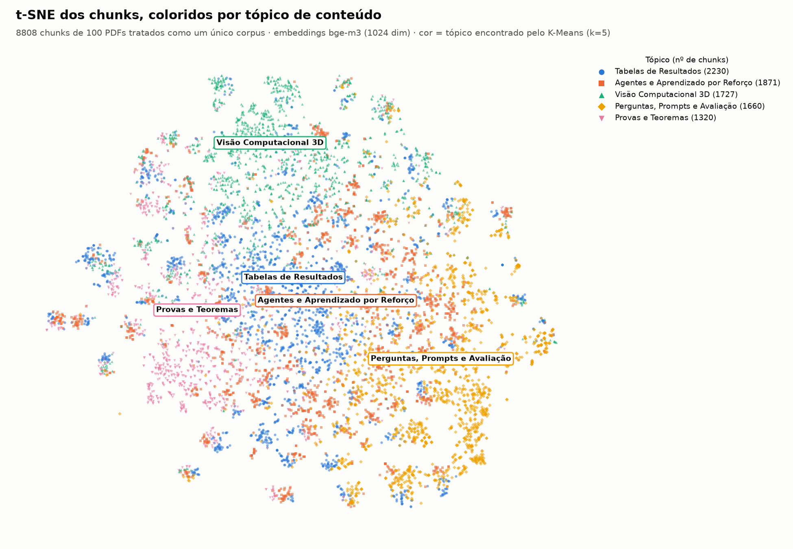 |

Um painel por tópico, com os outros em cinza, para ver onde cada um fica sem a sobreposição:

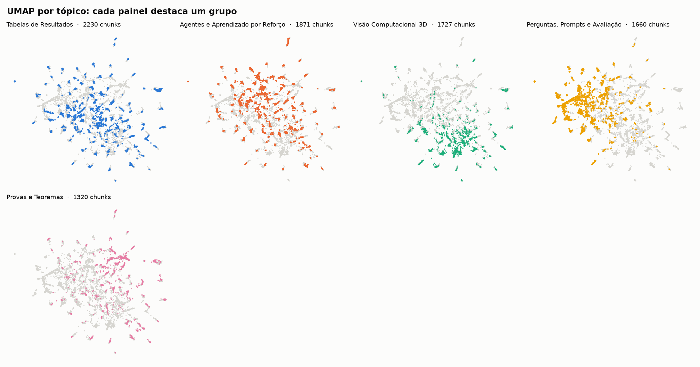

## 7. O chat responde de acordo com o conteúdo?

Fizemos 8 perguntas pela mesma API usada pela interface (`/api/chat`, collection `artigos_ia`):
- 7 sobre fatos específicos de artigos, com gabarito tirado do resumo no arXiv;
- 1 fora do corpus.

| # | Pergunta | Gabarito | Resultado |
| --- | --- | --- | --- |
| 1 | HOTA e FPS do ARC-SORT no SportsMOT | 81,82 HOTA, ~50 FPS | ✅ correto |
| 2 | Ganho de F1 do RAG-RST | nuclearidade 0,794 → 0,846; relação 0,738 → 0,788 | ✅ correto |
| 3 | Como o RAG privado protege o banco | projeção aleatória nos embeddings | ✅ correto |
| 4 | Tempo e mortes dos agentes Gemini no Minecraft | 27 h 14 min, 605 mortes | ✅ correto |
| 5 | Alcance do PSA-PPO na colheita de alface | 94,7%, braço UR10e | ✅ correto |
| 6 | Consultas falhas no PremiseSQL | 1.800 | ✅ correto |
| 7 | Modelo para o náuatle Masewalkopa | mT5-large, 58,46 chrF++ | ✅ correto |
| 8 | Receita de pão de queijo (fora do corpus) | deve recusar | ✅ disse que o contexto não tem a informação |

Em todas as respostas sobre artigos, os 5 trechos recuperados vieram do artigo certo, e a resposta citou o título dele. Cada resposta levou de 2 a 9 segundos. As respostas completas, com os trechos recuperados, estão em [`perguntas_chat.md`](perguntas_chat.md).

**Limitação observada:** em perguntas amplas, como *"Quais artigos falam sobre chain-of-thought?"*, a busca agora traz conteúdo relevante (artigos de raciocínio), mas o `qwen2.5:7b` é conservador. Se o termo exato não aparece nos trechos, ele responde que não encontrou. Um modelo maior ou um `top_k` maior devem ajudar nesse tipo de pergunta.

### Na interface do app

Capturas da tela **Busca por Similaridade** (http://localhost:5000), com a collection `artigos_ia`. Cada captura mostra a pergunta e os chunks que o Qdrant devolveu, ordenados pela similaridade de cosseno com a pergunta. Abaixo de cada imagem está a resposta que o LLM local gerou a partir desses chunks.

A tela original do app recebe a resposta do LLM mas só desenha os chunks. Por isso as respostas abaixo vêm da execução registrada em [`perguntas_chat.md`](perguntas_chat.md), que passa pelo mesmo serviço do chat. O template foi corrigido para mostrar a resposta acima dos chunks: veja `templates/index.html`, função `addChatMessage`.

#### 1. ARC-SORT

> **Pergunta:** Qual HOTA o ARC-SORT alcança no SportsMOT e a quantos FPS roda?

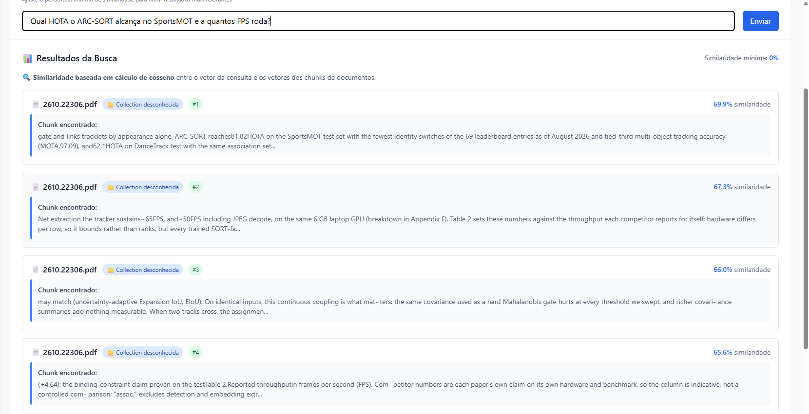

Os 4 chunks do topo vêm do artigo certo (`2610.22306.pdf`), com similaridade entre 65,6% e 69,9%. O primeiro traz "81.82 HOTA on the SportsMOT test set" e o segundo traz "~50 FPS including JPEG decode".

> **Resposta do LLM:** O ARC-SORT alcança um HOTA de 81,82 no teste do SportsMOT e roda a aproximadamente 50 quadros por segundo em uma GPU RTX 3060 de laptop, conforme mencionado na [Fonte: ARC-SORT: Adaptive, Robust, Compensated Multi-Object Tracking with Interacting Multiple Models].

✅ Bate com o gabarito: 81,82 HOTA, cerca de 50 FPS.

#### 2. RAG privado

> **Pergunta:** Como o artigo sobre RAG privado protege o banco de documentos?

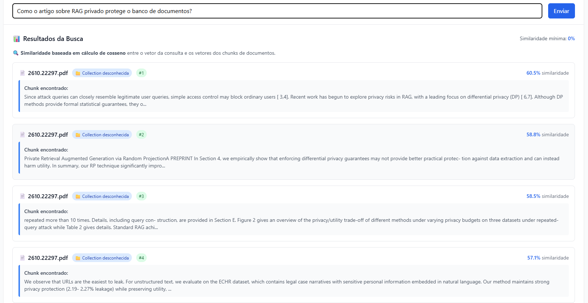

Todos os chunks vêm de `2610.22297.pdf` (*Private Retrieval Augmented Generation via Random Projection*). A similaridade é menor (57% a 60%) porque a pergunta é conceitual e não repete termos do texto. Mesmo assim, o artigo certo fica em todas as posições.

> **Resposta do LLM:** O artigo "Private Retrieval Augmented Generation via Random Projection" propõe uma técnica para proteger o banco de documentos contra ataques de extração usando projeção aleatória. De acordo com o texto, a técnica visa mitigar os riscos associados à proteção de privacidade baseada em diferencial de privacidade (DP), que pode degradar a qualidade do output devido às garantias de pior caso e à complexidade de implementação. […] a técnica de projeção aleatória mantém uma boa proteção de privacidade (2,19-2,27% de exposição) mesmo em textos não estruturados […]

✅ Bate com o gabarito: projeção aleatória aplicada aos embeddings. O valor de 2,19 a 2,27% de vazamento aparece no chunk #4 da captura.

#### 3. Agentes Gemini no Minecraft

> **Pergunta:** Quanto tempo os agentes Gemini 4 Argon levaram para derrotar o Ender Dragon?

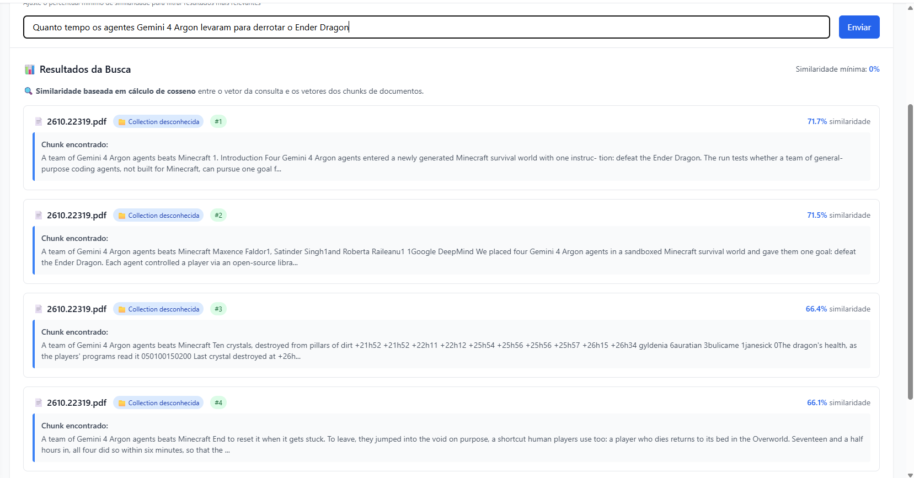

Todos os chunks vêm de `2610.22319.pdf`, com similaridade entre 66% e 72%: a introdução, o resumo e o trecho que descreve a luta final contra o dragão.

> **Resposta do LLM:** Os agentes Gemini 4 Argon levaram 27 horas e 14 minutos para derrotar o Ender Dragon no Minecraft, conforme mencionado na [Fonte: A team of Gemini 4 Argon agents beats Minecraft]. Ao longo desse processo, os agentes morreram 605 vezes, como informado na mesma fonte.

✅ Bate com o gabarito: 27 h 14 min e 605 mortes.

#### 4. PSA-PPO na colheita de alface

> **Pergunta:** Qual taxa de alcance o PSA-PPO obteve na colheita de alface e em que robô?

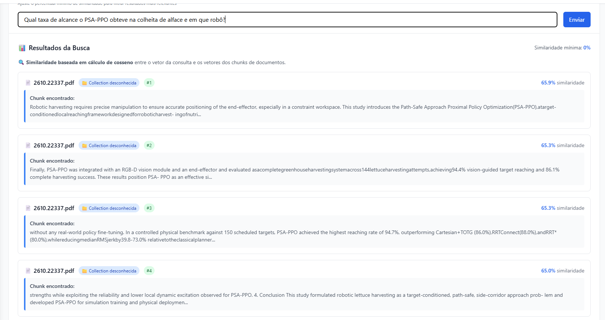

Todos os chunks vêm de `2610.22337.pdf`. O chunk #3 traz "PSA-PPO achieved the highest reaching rate of 94.7%" num benchmark físico de 150 alvos.

> **Resposta do LLM:** O PSA-PPO obteve uma taxa de alcance de 94,7% na colheita robótica de alface hidropônica em um benchmark físico controlado com 150 alvos programados. Este teste foi realizado com um braço robótico UR10e [Fonte: Sim-to-Real Reinforcement Learning for Path-Safe Target Reaching in Robotic Harvesting of Hydroponic Lettuce].

✅ Bate com o gabarito: 94,7% e braço UR10e.

**O que as capturas mostram:** nas quatro perguntas, a busca vetorial com `bge-m3` coloca o artigo certo em todas as posições do topo, mesmo com perguntas em português sobre artigos em inglês. A resposta do LLM usa só os números presentes nesses chunks e cita o título do artigo, que é o comportamento esperado de um RAG.

## Arquivos desta pasta

| Arquivo | Conteúdo |
| --- | --- |
| `qdrant/` | capturas do painel do Qdrant (seção 5) |
| `chat/` | capturas da tela de busca do app (seção 7) |
| `topicos_*.png` | gráficos gerados pelo script (seção 6) |
| `topicos.md`, `topicos.json` | tópicos, termos, artigos de cada um e nome sugerido pelo LLM |
| `nomes_topicos.json`, `nomes_topicos_v1.json` | nomes revisados à mão (depois e antes da limpeza) |
| `qdrant_*.json` | consultas para colar na aba *Visualize* do Qdrant |
| `perguntas_chat.md` | perguntas, respostas e trechos recuperados |
